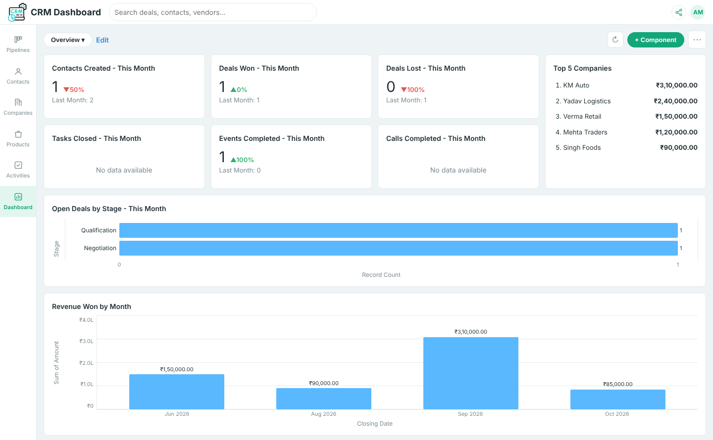
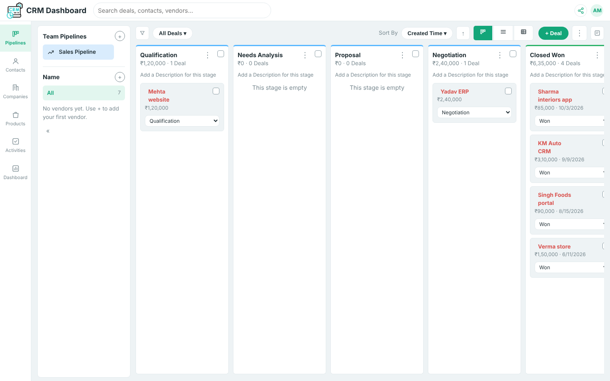

# CRM-DASHBOARD

I am thrilled to share that I have successfully built a fully working **CRM Dashboard** as a single-file web app! 🎉 This comprehensive dashboard gives a consolidated view of key sales metrics, deals, contacts, companies, vendors and activities in one place, with no backend or installation needed.

## 🔍 Key Features Include:

- Contacts Created – This Month (with change vs last month)
- Deals Won – This Month
- Deals Lost – This Month
- Tasks Closed, Events Completed and Calls Completed – This Month
- Top 5 Companies by deal value

## 📊 Detailed Visualizations:

- Open Deals by Stage
- Revenue Won by Month
- Top 5 Companies ranking
- KPI cards with month-over-month growth indicators
- Custom dashboards: add, edit, reorder and remove components (KPI or chart)

## 🗂️ Pipeline & CRM Modules:

- **Pipelines:** Kanban, list and table views with stage-wise totals, drag-free stage change, pipeline templates and multiple pipelines
- **Contacts & Companies:** records linked to deals and activities
- **Products & Vendors:** vendor panel with related deals, contacts, products and activities
- **Activities:** tasks, calls and events with calendar view
- **Deal detail page:** timeline, notes, emails and related contact info
- **Filters & Views:** advanced deal filters, saved custom views, displayed-fields chooser
- **Custom fields & picklists:** create and edit your own fields
- **Export:** download deals as CSV
- **Global search** across deals, contacts, vendors and more
- **Share link** and Recycle Bin for deleted records

## 🛠️ Tech Stack

- HTML, CSS and vanilla JavaScript in a single `index.html`
- Data is saved in your browser (`localStorage`), so it works offline with no server

## 🚀 How to Use

1. Download or clone this repository.
2. Open `index.html` in any modern browser.
3. Start adding deals, contacts and activities. The dashboard updates automatically.

This dashboard enables sales teams to monitor deals, track revenue and stay on top of follow-ups, ensuring a better experience for everyone.
